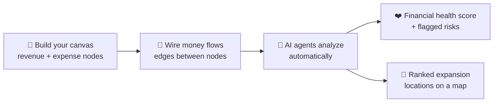
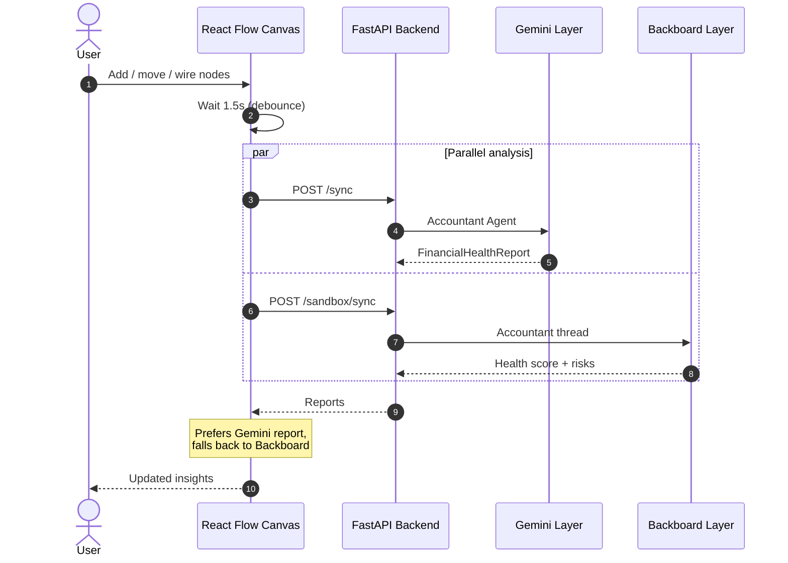
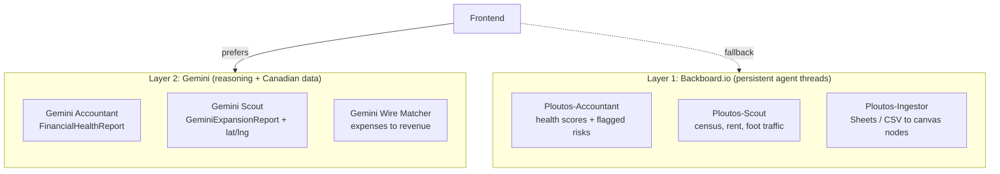
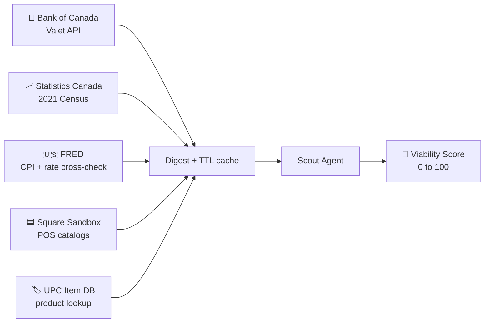
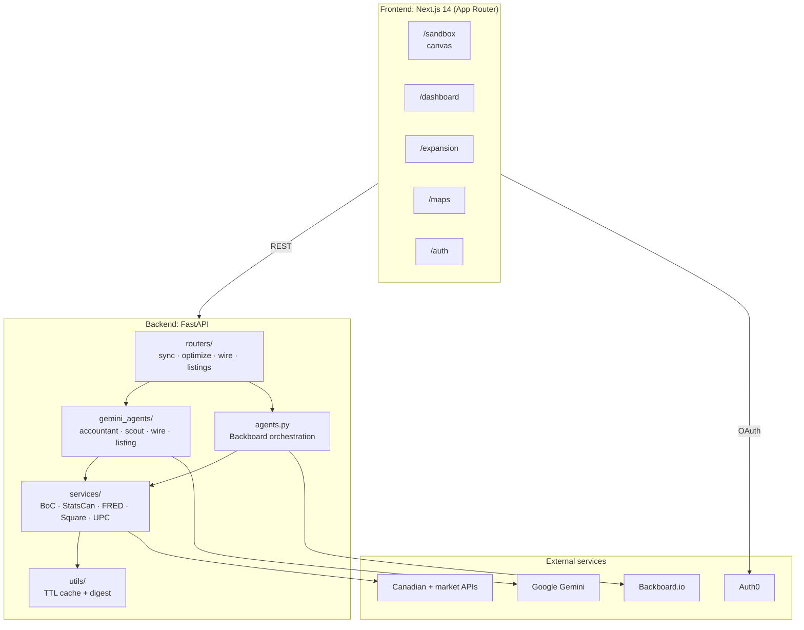
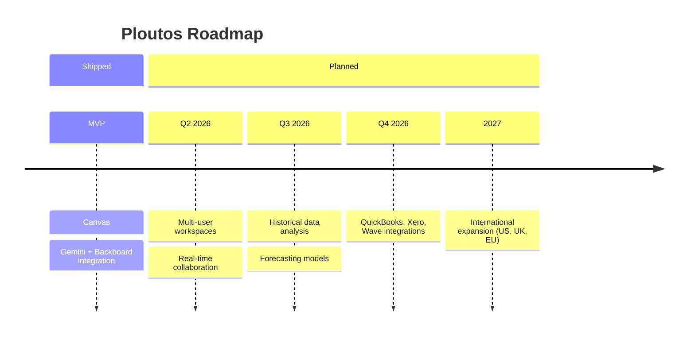

<div align="center">


# Ploutos

### A visual financial sandbox for Canadian small businesses

*Drag. Wire. Understand your money, and find out where to grow next.*

<br />


Built at [**Hack Canada 2026**](https://www.hackcanda.io/)

[Overview](#-overview) •
[How It Works](#-how-it-works) •
[Architecture](#-architecture) •
[Quick Start](#-quick-start) •
[API](#-api-reference) •
[Roadmap](#-roadmap)

</div>

---

## 📌 Overview

Most small business owners manage their finances in their heads, a spreadsheet that's three years old, or a napkin. **Ploutos** turns that chaos into a living canvas: drag your revenue streams and expenses onto a board, wire them together, and watch a team of AI agents figure out what it all means.

> **You shouldn't need an MBA to understand your burn rate**, or to know whether opening a second location in Winnipeg actually makes sense.

<!-- Add a screenshot or GIF of the sandbox here:
<p align="center"></p>
-->

### ✨ Key Features

| | Feature | Description |
|---|---|---|
| 🎨 | **Visual Canvas** | Drag-and-drop financial modeling built on React Flow |
| 🤖 | **Dual AI Layers** | Backboard persistent agents plus Gemini reasoning |
| 📊 | **Real Canadian Data** | Bank of Canada rates, StatsCan demographics, Square POS integration |
| 🗺️ | **Location Intelligence** | Viability scoring for expansion across 47+ Canadian cities |
| 🔐 | **Secure Auth** | Auth0 OAuth, with no custom session logic |
| ⚡ | **Real-time Sync** | 1.5s canvas debounce with parallel AI analysis |

---

## 🏗️ How It Works



### The Canvas

The core of the app is a **drag-and-drop financial board** built with [React Flow](https://reactflow.dev/). You drop nodes for:

- 💰 **Revenue sources**: product lines, service tiers, contracts
- 🧾 **Expense categories**: staff, overhead, operating costs
- 🔗 **Connections**: edges that model how money flows through your business

Every change triggers a **1.5-second debounce**, followed by two parallel backend calls to both AI intelligence layers. No button pressing required. The AI reacts in real time.



### The Two Intelligence Layers

We built two parallel AI stacks because each solved a different problem.



<details>
<summary><b>Layer 1: Backboard.io (persistent agent threads)</b></summary>

<br />

Uses [Backboard](https://backboard.io) for orchestration and multi-turn conversations:

- **Ploutos-Accountant**: analyzes canvas state, crunches financials, writes health scores and flagged risks
- **Ploutos-Scout**: expansion specialist using tool-call loops for census data, rent estimates, and foot traffic signals
- **Ploutos-Ingestor**: parses Google Sheets / CSV imports into structured canvas nodes

The Scout shows off Backboard's strength: agents keep memory across sessions without manual context stitching.

</details>

<details>
<summary><b>Layer 2: Gemini (reasoning + Canadian data)</b></summary>

<br />

For analysis that needs Canadian economic data, we call [Google Gemini](https://ai.google.dev/) directly via the `google-genai` SDK:

- **Gemini Accountant** → `FinancialHealthReport`
- **Gemini Scout** → `GeminiExpansionReport` with ranked locations and lat/lng for mapping
- **Gemini Wire Matcher** → intelligently connects expenses to revenue streams

The frontend prefers Gemini reports and falls back to Backboard if they're unavailable.

</details>

### 🇨🇦 Real Canadian Data Sources

The Viability Score isn't guessed. It's built from live data:



| Source | Data | API |
|---|---|---|
| **Bank of Canada** | Overnight rate, prime rate, CPI | Valet API |
| **Statistics Canada** | 2021 Census demographics (population, income, business density) | REST API |
| **FRED** | Cross-reference CPI and rate data | Federal Reserve |
| **Square Sandbox** | Real POS product catalogs | Transactions API |
| **UPC Item DB** | Product lookup for inventory | Public DB |

#### Viability Formula

```
Ve = (projected_revenue × demographic_score) / ((rent_cost × competition_factor) + fixed_overhead) × 40

Capped at 100
```

### 🔐 Authentication

Secure OAuth via [**Auth0**](https://auth0.com/), with zero custom session logic required.

---

## 🧩 Architecture



<details>
<summary><b>📁 Project structure</b></summary>

<br />

```
ploutos/
├── frontend/                    # Next.js 14 App Router
│   ├── app/
│   │   ├── sandbox/             # Main drag-and-drop canvas page
│   │   ├── dashboard/           # Business metrics overview
│   │   ├── expansion/           # Location selection interface
│   │   ├── maps/                # Interactive location map
│   │   ├── auth/                # Auth0 login/signup flow
│   │   └── api/auth/[auth0]/    # Auth0 callback handler
│   ├── components/
│   │   ├── FinancialSandbox.tsx     # Canvas container + handlers
│   │   ├── Navbar.jsx               # Navigation
│   │   ├── SummarySidebar.tsx       # Financial summary panel
│   │   ├── edges/                   # Custom React Flow edges
│   │   └── nodes/                   # Revenue/Expense/Group nodes
│   ├── hooks/
│   │   ├── useCanvasFinancials.ts       # Local financial calculations
│   │   ├── useSession.ts                # Session state management
│   │   └── useFinancialCalculation.ts   # Math utilities
│   ├── services/
│   │   ├── api.js                   # fetch() wrapper for backend calls
│   │   └── compassApi.ts            # Specialized API routes
│   ├── types/                       # Shared TypeScript interfaces
│   ├── utils/                       # Helpers (nodeFactory, groupLayout)
│   ├── lib/                         # Auth0 SDK config
│   └── public/                      # Static assets
│
└── backend/                     # FastAPI + Gemini + Backboard
    ├── main.py                  # App entrypoint, CORS, lifespan
    ├── config.py                # Pydantic config from .env
    ├── requirements.txt         # Dependencies
    ├── agents.py                # Backboard orchestration (legacy)
    ├── gemini_agents/           # Gemini intelligence layer
    │   ├── accountant_agent.py      # Financial analysis
    │   ├── scout_agent.py           # Location expansion
    │   ├── wire_agent.py            # Connection matching
    │   ├── listing_agent.py         # Inventory management
    │   └── tools.py                 # Shared tool definitions
    ├── models/                  # Pydantic request/response models
    │   ├── briefings.py             # AI agent output schemas
    │   ├── business.py              # Business entity models
    │   └── location.py              # Location/viability models
    ├── routers/                 # API route handlers
    │   ├── sync.py                  # POST /sync (Accountant)
    │   ├── optimize.py              # POST /optimize (Scout)
    │   ├── wire.py                  # POST /auto-wire
    │   └── listings.py              # POST /listings
    ├── routes/                  # Legacy Backboard routes
    │   ├── sandbox.py               # Old session endpoints
    │   ├── locations.py             # Location data + BestTime
    │   ├── dashboard.py             # Metrics (stub)
    │   └── optimizer.py             # Deprecated endpoint
    ├── services/                # External API clients
    │   ├── bankofcanada_service.py
    │   ├── fred_service.py
    │   ├── statscan_service.py
    │   ├── square_service.py
    │   └── upc_service.py
    ├── database/                # SQLite utilities (future)
    └── utils/
        ├── cache.py                 # TTL digest caching
        └── digest.py                # API response → briefing conversion
```

</details>

---

## 🚀 Quick Start

### Prerequisites

- **Node.js** 18+ and npm
- **Python** 3.11+
- API keys: [Gemini](https://aistudio.google.com/app/apikey), [FRED](https://fredaccount.stlouisfed.org/), [Auth0](https://auth0.com/)

### 1️⃣ Backend

```bash
cd backend

# Create virtual environment
python -m venv .venv
source .venv/bin/activate        # Windows: .venv\Scripts\activate

# Install dependencies
pip install -r requirements.txt

# Configure environment
cp .env.example .env
# Edit .env and add your API keys

# Start server
uvicorn main:app --reload --port 8000

# Verify health check
curl http://localhost:8000/health
```

### 2️⃣ Frontend

```bash
cd frontend

# Install dependencies
npm install

# Set up Auth0 (if using authentication)
# Add NEXT_PUBLIC_AUTH0_* to .env.local

# Start development server
npm run dev

# Open browser
open http://localhost:3000/sandbox
```

### 3️⃣ First Use

1. Go to [**localhost:3000/auth**](http://localhost:3000/auth) and sign in
2. Head to **/sandbox** to start building your financial model
3. Drag revenue and expense nodes onto the canvas
4. Watch the AI agents analyze your business in real time

### 🔑 Environment Variables

Copy [`.env.example`](backend/.env.example) to `.env` and fill in your keys:

| Variable | Source | Required |
|---|---|:---:|
| `GOOGLE_GEMINI_API_KEY` | [Google AI Studio](https://aistudio.google.com/app/apikey) | ✅ |
| `FRED_API_KEY` | [Federal Reserve FRED](https://fredaccount.stlouisfed.org/) | ✅ |
| `SQUARE_ACCESS_TOKEN` | [Square Developer](https://developer.squareup.com) | ➖ |
| `BACKBOARD_API_KEY` | [Backboard.io](https://backboard.io) | ➖ |
| `NEXT_PUBLIC_MAPBOX_TOKEN` | [Mapbox](https://www.mapbox.com) | ➖ |

> [!WARNING]
> Never commit `.env` files. They are in `.gitignore` for this reason.

---

## 🔌 API Reference

### Gemini Intelligence Layer

| Endpoint | Method | Purpose |
|---|:---:|---|
| `/health` | `GET` | Ping all 8 external APIs and report status |
| `/sync` | `POST` | Accountant Agent: analyze canvas and return `FinancialHealthReport` |
| `/optimize` | `POST` | Scout Agent: rank locations by Viability Score |
| `/optimize/macro` | `GET` | Macro trends briefing (cached 6hr) |
| `/auto-wire` | `POST` | Wire Matcher: intelligently connect expenses to revenue |

### Legacy Backboard Routes (preserved)

| Endpoint | Method | Purpose |
|---|:---:|---|
| `/session/start` | `POST` | Initialize Backboard thread pair |
| `/sandbox/sync` | `POST` | Backboard Accountant sync (legacy) |
| `/optimize/expansion` | `POST` | Backboard Scout location analysis |
| `/import/sheets` | `POST` | CSV/Sheets ingestor |

Full schemas live in the [OpenAPI docs](http://localhost:8000/docs) once the backend is running.

---

## 🧪 Development

<details>
<summary><b>Running tests</b></summary>

```bash
# Backend tests (future)
pytest backend/

# Frontend tests (future)
npm run test --prefix frontend
```

</details>

<details>
<summary><b>Debugging AI agents</b></summary>

All agent calls are logged at `INFO` level:

```bash
tail -f backend.log | grep "gemini\|backboard"
```

To test an individual agent in isolation:

```python
# backend/
from gemini_agents import accountant_agent
report = await accountant_agent.analyze(canvas_state)
print(report.json())
```

</details>

<details>
<summary><b>🐛 Troubleshooting</b></summary>

<br />

| Problem | Fix |
|---|---|
| **"Gemini API key not configured"** | Make sure `GOOGLE_GEMINI_API_KEY` is set in `.env`, then restart the backend. |
| **Frontend can't reach backend** | Check that the CORS origin in `backend/main.py` matches your frontend URL (default `http://localhost:3000`). |
| **Canvas doesn't sync** | Open DevTools (`F12`) → Network tab and verify `/sync` returns `200`. |
| **Viability scores are low** | Make sure `FRED_API_KEY` is set and external APIs are reachable. Check `/health` for missing services. |

</details>

---

## 🎯 Roadmap



- [x] MVP: Canvas + Gemini + Backboard integration
- [ ] **Q2 2026**: Multi-user workspaces + real-time collaboration
- [ ] **Q3 2026**: Historical data analysis + forecasting models
- [ ] **Q4 2026**: Integration with QuickBooks, Xero, Wave
- [ ] **2027**: International expansion (US, UK, EU)

---

## 🤝 Contributing

Contributions are welcome! See [CONTRIBUTING.md](CONTRIBUTING.md) for the full guide.

1. **Fork** the repo and create a feature branch: `git checkout -b feature/your-feature`
2. **Make changes** following the existing code style
3. **Test thoroughly** and make sure no new errors are introduced
4. **Open a Pull Request** with a clear description
5. **Link related issues** with `Closes #123`

**Code style:** Python follows [PEP 8](https://www.python.org/dev/peps/pep-0008/) via `black` + `flake8`. JS/TS uses [Prettier](https://prettier.io/) + [ESLint](https://eslint.org/). Commit messages are lowercase and imperative (`add feature`, not `added feature`).

**Good first areas:**

- Add unit tests for agent logic
- Improve error handling for external API failures
- Optimize React Flow rendering for large canvases (1000+ nodes)
- Expand location data sources (international)
- Improve mobile responsiveness
- Performance profiling and caching strategies

---

## 🛠️ Built With

| | Tool | Used for |
|---|---|---|
| 🎨 | [React Flow](https://reactflow.dev/) | Visual canvas |
| ⚛️ | [Next.js](https://nextjs.org/) | Full-stack React framework |
| ⚡ | [FastAPI](https://fastapi.tiangolo.com/) | High-performance Python API |
| 🧠 | [Backboard.io](https://backboard.io) | Agent thread orchestration + persistent memory |
| ✨ | [Google Gemini](https://deepmind.google/technologies/gemini/) | Financial analysis + location viability reasoning |
| 🔐 | [Auth0](https://auth0.com) | Authentication |
| 🟦 | [Square](https://developer.squareup.com) | Real product catalog data |
| 🏦 | [Bank of Canada Valet API](https://www.bankofcanada.ca/valet/docs) | Live interest rates and CPI |
| 📈 | [Statistics Canada](https://www.statcan.gc.ca) | 2021 Census demographics |
| 🇺🇸 | [FRED](https://fred.stlouisfed.org) | Economic indicator cross-reference |
| 🏷️ | [UPC Item DB](https://www.upcitemdb.com) | Product lookup |

---

## 📜 License

Released under the **MIT License**. See [LICENSE](LICENSE) for details.

---

<div align="center">

Made with ❤️ at [Hack Canada 2026](https://www.hackcanda.io/)

*We just want Canadian small businesses to have tools that don't suck.*

</div>
